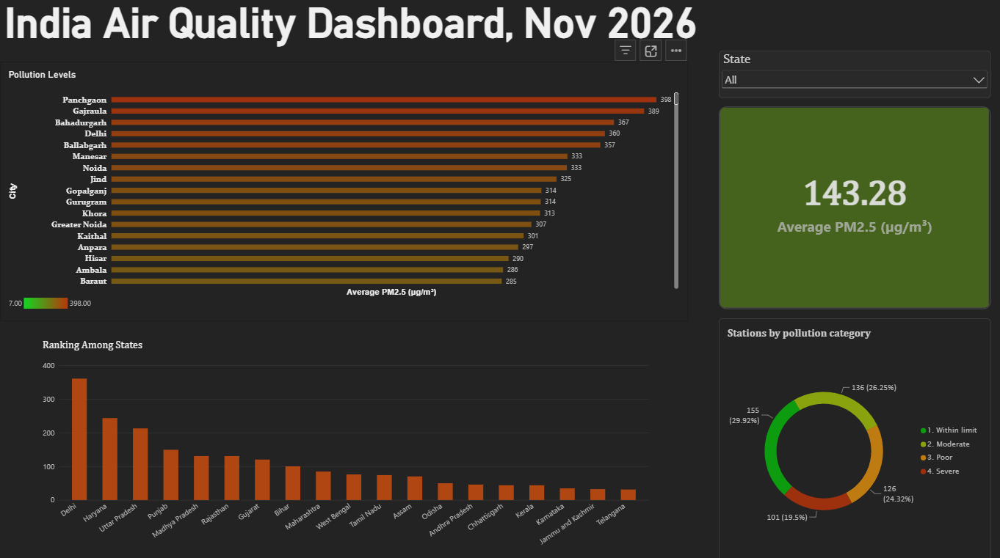
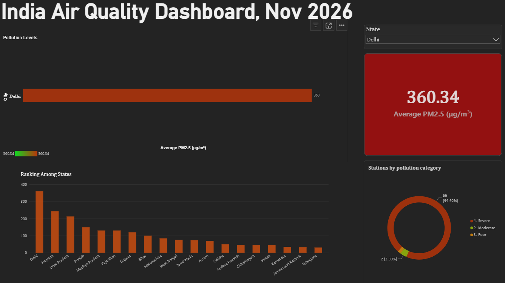
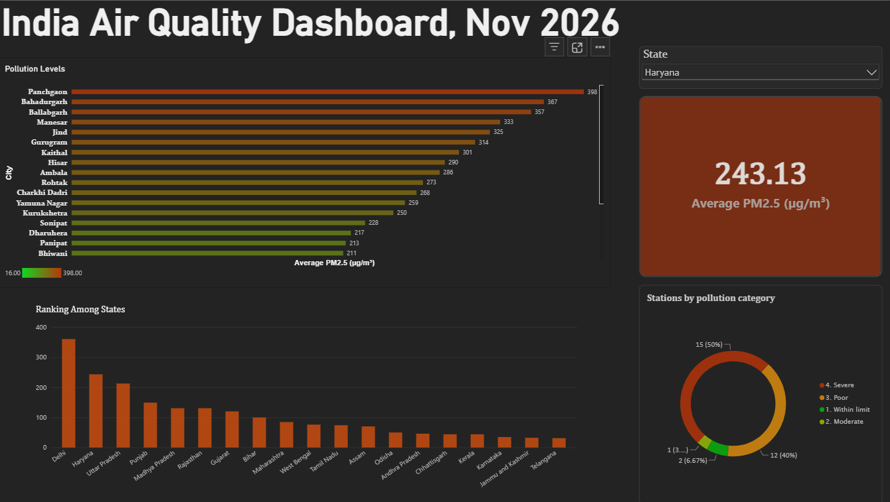

# India Air Quality Dashboard (MySQL + Power BI)

An interactive dashboard built on a real, live air quality snapshot from India's national monitoring network, taken on **4 Nov 2026**. Raw CSV data was cleaned and analysed in **MySQL**, and visualised in **Power BI**.



## Questions this project answers

- Which cities and states have the worst PM2.5 pollution?
- How many station readings exceed the safe limit?
- How does Delhi compare with the rest of the country?
- How much data is missing, and where?

## Key findings

- **Delhi-NCR dominates the pollution rankings.** Delhi, Noida, Gurugram, Greater Noida, Ghaziabad and Faridabad lead the list of cities with 3 or more stations.
- **Delhi averages 360 µg/m³ PM2.5 across 59 stations.** 56 of its 59 stations fall in the "severe" band, and every Delhi station is above the 60 µg/m³ limit.
- **State ranking:** Delhi (360.3), Haryana (243.1) and Uttar Pradesh (212.5) are the top three. Southern states such as Karnataka (34.7) and Telangana (31.1) are under the limit.
- **About 7 in 10 PM2.5 readings exceed 60 µg/m³** (363 of 518 readings; 101 are in the severe band).
- **PM2.5 and PM10 both peak at exactly 500**, which looks like a sensor reporting cap rather than a true reading.

| PM2.5 band (µg/m³) | Readings |
|---|---|
| Within limit (≤ 60) | 155 |
| Moderate (61-120) | 136 |
| Poor (121-250) | 126 |
| Severe (> 250) | 101 |

*These bands are simplified for this project and are not the official CPCB AQI table.*

## Dashboard features

- State slicer that filters the cards, city chart and donut together
- Average PM2.5 card
- City ranking bar chart with a green-to-red gradient
- National state ranking chart (set to ignore the slicer so the full ranking always shows)
- Donut chart of stations by pollution category

| Delhi selected | Haryana selected |
|---|---|
|  |  |

## Data and cleaning

- **Source:** data.gov.in, real-time air quality index data (one row per station per pollutant).
- **Size:** 3,913 rows. 3,587 have valid readings and **326 are `NA`**, spread across 144 stations. No station was entirely blank.
- **Approach:**
  1. Load the CSV untouched into `aqi_raw`, with every column as text.
  2. Build `aqi_clean` with proper types: `NA` becomes `NULL` (never 0), dates become `DATETIME`, and text is trimmed.
  3. Add helper columns: `load_date` (snapshot date, so daily loads can be appended) and `is_missing` (flags `NA` readings).
  4. Validate: row counts match, 0 bad dates, all coordinates fall inside India.
  5. Expose small, purpose-built **views** for Power BI.

## SQL skills used

`GROUP BY`, `HAVING`, `CASE WHEN`, `JOIN`-ready dimension view, window function `RANK() OVER`, `CAST`, `NULLIF`, `TRIM`, `STR_TO_DATE`, `SUBSTRING_INDEX`, subqueries, `CREATE VIEW`, and data validation queries.

## Data model (Power BI)

`v_states` is a one-row-per-state dimension table. It has a one-to-many relationship with `v_station_map`, `v_pm25_category`, `v_state_rank` and `v_top_cities`, so a single slicer filters everything.

## Limitations

- **Single-day snapshot.** These are readings from around one hour, not a 24-hour average, so they should not be read as a daily AQI. No trend analysis is possible yet.
- **Single-station cities rank high.** Cities like Panchgaon and Gajraula appear at the top of the unfiltered city chart based on one sensor. The SQL view `v_top_cities` keeps only cities with 3 or more stations.
- **Mixed units.** CO is typically reported in mg/m³ and other pollutants in µg/m³, so averages should be compared within a pollutant only.
- **Station names are inconsistent** (spacing and separators vary), so `DISTINCT station` is used instead of cleaning names.
- Delhi is recorded as a state in the source data.

## Future improvements

- Collect data daily with a small script (the `load_date` column is already in place) to add trends
- Add a pollutant slicer (the `v_pollutants` view is ready)
- Add a station map with a green-to-red gradient
- Add a Data Quality page showing missing readings by pollutant and state

## Repository contents

```
.
├── README.md
├── aqi_analysis.sql           # full SQL, in run order
├── india_air_quality.pbix     # Power BI report
└── screenshots/
    ├── dashboard_all.png
    ├── dashboard_delhi.png
    └── dashboard_haryana.png
```

## How to reproduce

1. Download the AQI CSV from data.gov.in.
2. Run `aqi_analysis.sql` section by section in MySQL Workbench (import the CSV into `aqi_raw` after Section 1).
3. Open `india_air_quality.pbix` in Power BI Desktop and point it to your local MySQL (`localhost`, database `air_quality`). The MySQL Connector/NET must be installed.

## Tools

MySQL 8.0, MySQL Workbench, Power BI Desktop

## Data source

Open government data from [data.gov.in](https://data.gov.in), used under the Government Open Data License - India.

## Author

**Luv Kumar** | [LinkedIn](https://www.linkedin.com/in/luv-kumar-26570b28a/) | [GitHub](https://github.com/luv-k)
